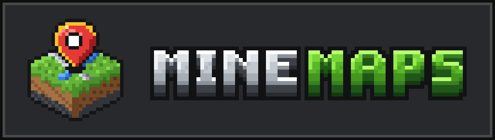
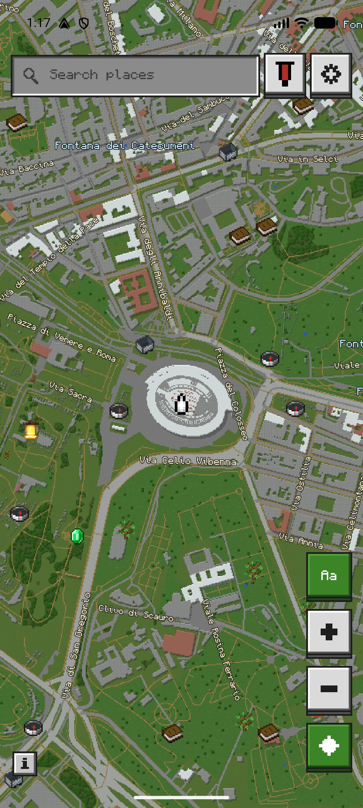
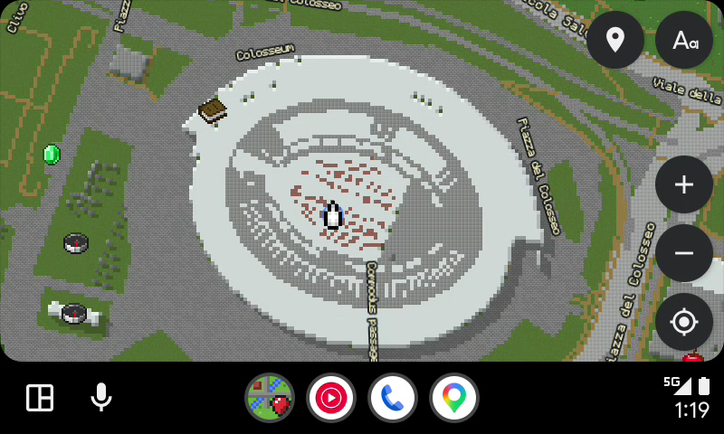

  

**MineMaps** turns the real world into a Minecraft-style block map on your Android phone and in your car with **Android Auto**.

Roads, buildings, parks, forests, rivers, and landmarks from around the world are drawn onto a block grid with pixel-art icons, day and night lighting, place search, and saved bookmarks.

<table>
  <tr>
    <th align="center">Android Phone</th>
    <th align="center">Android Auto (Full Screen)</th>
  </tr>
  <tr>
    <td align="center">
      
    </td>
    <td align="center">
      
    </td>
  </tr>
</table>

> *Disclaimer: The screenshots above are shown with the optional in-app Minecraft texture pack enabled. Minecraft textures and assets are © Mojang Studios. MineMaps is an independent project and is not affiliated with, endorsed by, or associated with Mojang Studios or Microsoft. MineMaps downloads and releases ship **only** original MineMaps pixel art and never include Mojang assets. Map data © OpenMapTiles © OpenStreetMap contributors.*

---

## What You Can Do

- **Explore the real world in blocks** — Pan, pinch to zoom from a world overview down to individual street blocks, and twist with two fingers to rotate the map (tap the compass to face north again).
- **Use it in your car with Android Auto** — MineMaps sits in Android Auto's main map slot just like Google Maps or Waze: use it **full screen** or **side-by-side** with your music and media apps.
- **Three navigation modes (Settings → Navigation):**
  1. **Standalone (OpenStreetMap / OSRM):** Tap **Navigate** on any place to draw a pixel-art route line across the block map with live turn banners, distance, and ETA — completely free with no API keys.
  2. **Google Maps Assisted:** Mirror live turn-by-turn notifications from the Google Maps app running on your phone, share places directly from Google Maps into MineMaps, or optionally paste your own Google Maps API key to enable Google Places business search and live traffic-coloured routes (green / amber / red).
  3. **Off (Map only):** Pure block-world exploration without route lines or navigation banners.
- **Search & inspect places** — Search for cities, landmarks, streets, and shops, or tap anything on the map to see what it is.
- **Save your favourite places** — Long-press anywhere on the map (or save from a search result) to bookmark a spot with your choice of 34 pixel-art item icons. Your saved places also show up on the car screen, sorted by distance.
- **Customise the look** — Switch between day, night, or automatic themes, pick your player arrow colour, toggle street names (`Aa`) or map icons, and display place names in **English (Latin script)** or in each region's local language.
- **Works offline for visited areas** — Areas you've already viewed stay cached on your phone (up to 200 MB for 30 days).

---

## Install on Your Phone

1. Go to [**GitHub Releases**](https://github.com/rh45-one/MineMaps/releases) on your phone and download the latest `MineMaps-vX.Y.Z.apk`.
2. Open the downloaded file to install it. If Android asks, allow installs from your browser or file manager.
   - *Note:* Because the app is installed outside the Play Store, Google Play Protect may show an "unrecognised developer" prompt the first time — tap **More details → Install anyway**.
3. Open **MineMaps** and grant location permission when asked.

### Keeping MineMaps Updated

MineMaps checks GitHub Releases for updates automatically (once a day by default) and lets you download and install new versions right inside the app.
- You can change how often it checks (**Every launch**, **Daily**, **Weekly**, or **Manual only**) or tap **Check now** in **Settings → Updates**.
- Every update is verified against its SHA-256 checksum and signing key before Android installs it.

### Moving Your Saved Places Between Installs

You can back up or move your bookmarks at any time in **Settings → Saved places → Export / Import** (for example, when switching phones or moving from a self-built copy to an official release).

---

## Using MineMaps on Android Auto

Because MineMaps is installed from GitHub rather than the Google Play Store, follow these steps on your phone so Android Auto shows it in your car:

1. On your phone, open **Settings** and search for **Android Auto** (or open the Android Auto app settings).
2. Scroll all the way to the bottom and tap **Version** about 10 times until it asks to enable developer mode, then tap **OK**.
3. Tap the **three-dot menu (⋮)** in the top-right corner and open **Developer settings**.
4. Tap **Application Mode** and set it to **Developer**, and scroll down to check **Unknown sources**.
5. **Android Auto 14+ installer check:** Modern Android Auto (`v14+`) also verifies that `CarAppService` apps were installed through Google's Package Installer with Play Store installer metadata.
   - If MineMaps does not appear in **Android Auto → Customise launcher** right after a browser install, either install an update once through MineMaps' in-app updater (which invokes Google Package Installer with the required metadata) or install over USB with `tools/phone.sh --release`.
6. Check **Customise launcher** in the main Android Auto settings to make sure **MineMaps** is ticked.

Next time you connect your phone to your car, **MineMaps** will appear in your Android Auto app launcher and can take the main map view (full screen or split dashboard).

---

## Optional: Official Minecraft Textures & Custom Resource Packs (`.zip`)

Out of the box, MineMaps uses its own original pixel art. You can switch the map, item icons, player arrow, and bookmark banners to **official Minecraft: Java Edition textures** or any **custom Minecraft resource pack (`.zip`)** directly on your phone.

### 1. Official Vanilla Minecraft Textures
1. Open **Settings → Textures & Appearance**, tap **Minecraft textures**, and choose **Download now** (downloads the official Minecraft client jar — about 41 MB — directly from Mojang's servers, builds the texture atlas on your phone, and deletes the download) or **Next update** (downloads automatically on Wi-Fi after your next app update).

### 2. Importing a Custom Resource Pack (`.zip`)
You can theme the entire real-world map with your favourite Minecraft resource pack (such as *Faithful 32x/64x*, *Bare Bones*, *Jappa*, seasonal packs, or your own custom pack):

1. Download any **Minecraft: Java Edition resource pack (`.zip`)** to your phone (up to 200 MB). Do **not** unzip it.
2. Open **Settings → Textures & Appearance** and tap **Import resource pack (.zip) / JAR…**.
3. Pick the `.zip` file. MineMaps builds the atlas on-device and switches to it immediately.

#### Specifics & Tips for Custom Resource Packs
- **Layering over Vanilla (Recommended):** If you install the **Vanilla Minecraft** textures *first* and then import a custom `.zip` resource pack on top, **MineMaps automatically layers the custom pack over your installed Vanilla textures**. Any block or item icon that the custom pack doesn't include will keep its Vanilla Minecraft texture (instead of reverting to the default pack). You can tap **Reset to Vanilla Minecraft** at any time to go back to pure Vanilla.
- **Supported Resolutions (`16×16`, `32×32`, `64×64`, `128×128+`):** Higher-resolution HD resource packs are automatically box-downsampled with premultiplied alpha to crisp `16×16` tiles, and animated texture strips (like `water_still.png`) automatically extract their frames.
- **Supported Minecraft Versions (`1.8` through `1.21+`):** Both modern (`assets/minecraft/textures/block/` & `item/`) and legacy pre-1.13 (`assets/minecraft/textures/blocks/` & `items/`) folder structures and texture names (e.g. `dirt_path_top` / `grass_path_top`, `oak_leaves` / `leaves_oak`, `golden_apple` / `apple_golden`) are supported. Zip files may have `assets/` at the root or nested inside a single top-level folder.
- **Colormaps:** If your resource pack includes custom `textures/colormap/grass.png` and `foliage.png`, MineMaps samples them to tint grass, parks, and forest canopies; if a pack omits colormaps, MineMaps automatically applies standard plains and forest biome tints.
- **Which Minecraft textures map to real-world geography:**
  - **Terrain & Water:** `block/grass_block_top` (land & parks), `block/oak_leaves` (forests/woods), `block/water_still` (oceans, rivers, lakes), `block/sand` (beaches/deserts), `block/snow` (glaciers/peaks), `block/mud` or `block/dirt` (wetlands), `block/farmland_moist` + `block/wheat_stage3`/`7` (farmland), `block/poppy` & `block/dandelion` (park flowers).
  - **Roads & Paths:** `block/gray_concrete` (motorways/primary roads), `block/cobblestone` & `block/stone_bricks` (streets & residential roads), `block/dirt_path_top` (footpaths/trails), `block/gravel` + `block/rail` (railways), `block/smooth_stone` (plazas/aprons).
  - **Buildings:** `block/bricks`, `block/oak_planks`, `block/spruce_planks`, `block/polished_andesite`, `block/white_concrete`, and `block/terracotta`.
  - **Map Markers & Icons:** `map/decorations/player` (your GPS arrow), `map/decorations/red_banner` (search pin), `entity/chest/normal` (chest icon), plus standard `item/*` textures (`compass_00`, `book`, `diamond`, `emerald`, `apple`, `bread`, `cooked_beef`, `potion`, `minecart`, `iron_pickaxe`, `iron_sword`, `lantern`, etc.).

Your imported textures are stored privately on your phone and **stay intact across app updates**.

---

## Privacy

- **No accounts, no ads, no analytics, no tracking.**
- Your location is read directly from your phone's GPS/location service (`LocationManager` — Google Play Services is not required) and is only used on your device to draw your position on the map and bias nearby search results.
- Map tiles are fetched from [OpenFreeMap](https://openfreemap.org/) (OpenStreetMap data) and place searches use [Photon](https://photon.komoot.io/). Automatic update checks contact GitHub (and can be turned off by setting **Settings → Updates** to **Manual only**).

---

## Developer Guide & Documentation

Want to build MineMaps from source, run the desktop map renderer, test with the Android Auto head unit emulator, or see how the block engine works?

👉 **Read the [Developer Guide (`docs/DEVELOPMENT.md`)](docs/DEVELOPMENT.md)**

Additional technical documents in [`docs/`](docs/):
- [`docs/ADR-001-architecture.md`](docs/ADR-001-architecture.md) — Architecture decisions
- [`docs/ENGINE-SPEC.md`](docs/ENGINE-SPEC.md) — Block map engine specification
- [`docs/ASSETS.md`](docs/ASSETS.md) — Art & icon specification
- [`docs/RELEASING.md`](docs/RELEASING.md) — Release & signing workflow
- [`docs/STATUS.md`](docs/STATUS.md) — Test & verification status
- [`docs/THIRD_PARTY.md`](docs/THIRD_PARTY.md) — Third-party attributions & licences

---

## Licence & Credits

- See [`LICENCE`](LICENCE) for the project licence (Creative Commons Attribution-NonCommercial 4.0 International) and [`docs/THIRD_PARTY.md`](docs/THIRD_PARTY.md) for third-party software, font, and map data licences.
- Map data: [OpenFreeMap](https://openfreemap.org/) © [OpenMapTiles](https://openmaptiles.org/) — Data from [OpenStreetMap](https://www.openstreetmap.org/copyright).
- Search: [Photon](https://photon.komoot.io/) by Komoot (OpenStreetMap data).
- Font: [Monocraft](https://github.com/IdreesInc/Monocraft) by Idrees Hassan (SIL OFL 1.1).
